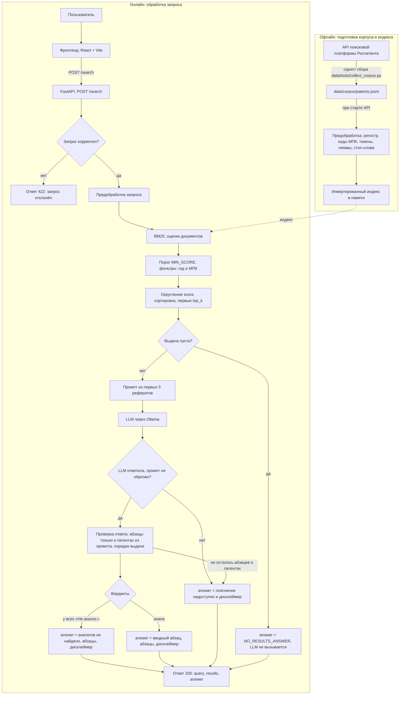
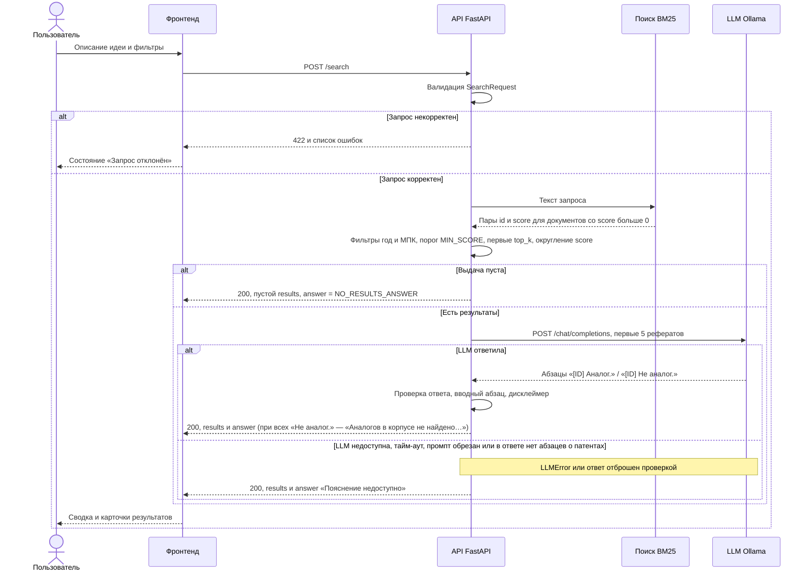

# Архитектура «Патентного радара»

Документ описывает устройство системы, контракт HTTP API между фронтендом и бэкендом и выбор языковой модели. Ответственный — Коля (интеграция). Состояние — контрольная точка 2 (КТ2): `POST /search` ищет собственным BM25 по корпусу из 200 рефератов и поясняет первые 5 результатов через локальную LLM; что сделано — раздел 5.

Связанные документы: [product.md](../product/product.md) и [scenarios.md](../product/scenarios.md) — продукт и пользовательские сценарии (Ника), [rag.md](rag.md) — поиск BM25 и RAG (Бобур).

## 1. Назначение и границы

«Патентный радар» — инструмент первичного поиска аналогов. Пользователь описывает идею изобретения обычными словами, система находит похожие патенты РФ в корпусе рефератов с помощью собственной реализации BM25, а локальная языковая модель (LLM) кратко объясняет сходства и отличия со ссылками на номера патентов.

Границы:

- **Корпус** — рефераты (INID 57) и названия (INID 54) патентов РФ на изобретения из официальных публикаций Роспатента: корпус собран заранее скриптом `data/tools/collect_corpus.py` через API поисковой платформы Роспатента, каждый документ открывается по номеру в открытом реестре ФИПС. Коды МПК (INID 51) и год публикации (INID 45) — метаданные для фильтров и показа. Полные описания и формулы в корпус не входят; обоснование — в [rag.md](rag.md).
- **Не юридическое заключение.** Ответ помогает найти аналоги, но не оценивает новизну и патентоспособность; каждый ответ с результатами заканчивается дисклеймером.
- **Данные не уходят в облако.** Поиск выполняется в процессе API, LLM работает на том же компьютере через Ollama.
- **Локальное приложение для одного пользователя:** без авторизации и без базы данных. API не сохраняет запросы; в журнал uvicorn попадают адрес клиента, метод, путь и код ответа, но не текст запроса.
- **Вне рамок:** семантический поиск по эмбеддингам, загрузка документов в работающее приложение (корпус собирается заранее, офлайн, скриптом сбора), зарубежные патенты, развёртывание на сервере.

## 2. Компоненты и зоны ответственности

| Модуль | Файлы | Владелец | Назначение |
|---|---|---|---|
| Интерфейс | `frontend/` | Ника | Vite + React + TypeScript + Tailwind: экран запроса, выдача, карточка патента; слой `frontend/src/api/` и мок `frontend/src/mock/search.json` |
| HTTP API | `app/api/main.py` | Коля | приложение FastAPI: `GET /health`, `POST /search`, загрузка `.env` |
| Контракт API | `app/api/schemas.py` | Коля | Pydantic-модели запроса и ответа, правила валидации |
| Конвейер поиска | `app/api/pipeline.py` | Коля | `SearchPipeline`: корпус и индекс при старте, BM25, порог `MIN_SCORE`, фильтры, `top_k`, вызов LLM, деградация (разделы 3 и 8); тот же конвейер вызывает `benchmark/evaluate_answers.py` |
| Поле `answer` | `app/api/answer.py` | Коля | проверка ответа LLM (ссылки, порядок абзацев, вердикты) и сборка `answer`: вводный абзац, абзацы о патентах, дисклеймер (разделы 4.5 и 8) |
| Клиент LLM | `app/llm/client.py` | Коля | запросы к OpenAI-совместимому API, выбор провайдера через `.env`; `complete()` возвращает текст, `usage` и `finish_reason` |
| Модель проекта | `Modelfile` | Коля | `patent-radar:7b` — qwen2.5:7b с окном контекста 8192 токена (раздел 6) |
| Промпт LLM | `app/llm/prompts.py` | Бобур | системный промпт, `build_messages(query, results)`, `MAX_CONTEXT_DOCS = 5`, разбор вердикта `verdict()` |
| Предобработка | `app/search/preprocess.py` | Бобур | регистр, коды МПК, токенизация, лемматизация pymorphy3, стоп-слова |
| Индекс | `app/search/index.py` | Бобур | собственный инвертированный индекс `term → {doc_id: tf}`, длины документов |
| Ранжирование | `app/search/bm25.py` | Бобур | формула BM25 с параметрами `k1` и `b` |
| Поиск по корпусу | `app/search/engine.py`, `app/search/config.py` | Бобур | `SearchEngine` — документы корпуса → индекс → BM25; выбранная конфигурация и `MIN_SCORE` |
| Корпус | `data/sample/patents.jsonl`, `data/corpus/patents.jsonl`, `data/corpus/groups.json`, `data/tools/collect_corpus.py` | Бобур | 3 демо-записи (КТ1) и реальные рефераты (КТ2); состав корпуса по темам и группам; скрипт сбора через API Роспатента |
| Benchmark | `benchmark/queries.jsonl`, `traps.jsonl`, `offtopic.jsonl`, `pooling.jsonl`, `experiments.py`, `evaluate_answers.py` | Бобур | 24 запроса с разметкой и эталонами, 5 ловушек, 10 посторонних запросов; тетрадка marimo с экспериментами; прогон ответов |
| Тесты | `tests/test_api.py`, `tests/test_llm_client.py`, `tests/test_search.py` | Коля; `test_search.py` — Бобур по согласованию | контракт API, конвейер, клиент LLM, поиск — без сети и Ollama |
| Спецификации | `spec/product/`, `spec/tech/rag.md`, `spec/tech/architecture.md` | Ника, Бобур, Коля | продукт и сценарии; поиск и RAG; архитектура и контракт |
| Общие файлы | `README.md`, `AGENTS.md`, `CLAUDE.md`, `CHANGE_HISTORY.md`, `.gitignore`, `requirements.txt`, `.env.example`, `pytest.ini`, `Modelfile` | Коля | описание проекта, правила работы, история изменений, зависимости, настройки |

Зависимости: `app/api` вызывает поиск (`app/search`) и LLM (`app/llm`); поиск и промпт не зависят от FastAPI и проверяются отдельно, в том числе в тетрадке benchmark; фронтенд общается с бэкендом только по HTTP-контракту из раздела 4.

## 3. Пайплайн

### 3.1. Схема

Офлайн-часть готовит корпус и индекс, онлайн-часть обрабатывает каждый запрос. Реализация — `app/api/pipeline.py` и `app/api/answer.py`.



- Рефераты собраны заранее скриптом `data/tools/collect_corpus.py` через API поисковой платформы Роспатента (формат записи и порядок сбора — `data/sample/README.md`) и лежат в `data/corpus/patents.jsonl`. Приложение в сеть за документами не ходит. Индекс строится при старте API: для сотен рефератов это доли секунды, отдельное хранилище не нужно.
- Запрос проходит ту же предобработку, что и документы; шаги и их порядок — в [rag.md](rag.md).
- BM25 оценивает документы корпуса с выбранной конфигурацией (`app/search/config.py`; эксперименты — [rag.md](rag.md), раздел 13). IDF считается по всему корпусу, поэтому фильтры не меняют оценок. Фильтры по году и МПК применяются до обрезки до `top_k`: иначе выдача с фильтром могла бы оказаться короче `top_k`, хотя подходящие документы есть.
- `score` округляется до 2 знаков, и выдача сортируется по убыванию округлённого `score`, при равенстве — по `id`: так порядок в ответе всегда согласован с показанными оценками. От порядка в тетрадке benchmark он может отличаться только у документов, чьи оценки различаются меньше чем на 0,005.
- «Ничего не найдено» — после фильтров не осталось ни одного документа с `score ≥ MIN_SCORE`. Порог `MIN_SCORE = 4.42` подобран на benchmark ([rag.md](rag.md), разделы 7 и 13.7); если у запроса и документа нет общих терминов, оценка равна 0. В этом случае LLM не вызывается.
- В промпт попадают первые 5 результатов (`MAX_CONTEXT_DOCS = 5` в `app/llm/prompts.py`): главная метрика выбора конфигурации поиска — Recall@5, а пять коротких рефератов помещаются в окно контекста небольшой модели (как его задаёт Ollama — раздел 6).
- Модель пишет по абзацу о каждом из 5 патентов с вердиктом «Аналог.» или «Не аналог.». API проверяет ответ (раздел 8), добавляет вводный абзац и дисклеймер; если у всех патентов вердикт «Не аналог.», вводный абзац сообщает, что аналогов в корпусе не найдено (раздел 4.5).

### 3.2. Последовательность POST /search



Фронтенд проверяет те же правила до отправки и при ошибке показывает подсказку под полем, не отправляя запрос ([scenarios.md](../product/scenarios.md)). API проверяет их повторно, потому что к нему можно обратиться и напрямую (Swagger, curl). Если проверки на обеих сторонах совпадают, интерфейс ответа 422 не получает; иначе показывает состояние «Запрос отклонён».

## 4. Контракт API

Контракт одинаков для бэкенда (`app/api/schemas.py`), тестов (`tests/test_api.py`) и фронтенда (`frontend/src/api/`, мок `frontend/src/mock/search.json`). Изменение контракта — это согласованное изменение всех трёх мест и этого раздела.

### 4.1. Общее

- Адрес бэкенда при разработке — `http://127.0.0.1:8000`. Фронтенд в режиме `api` обращается к `/api/...`, а dev-сервер Vite проксирует такие запросы на бэкенд (раздел 9).
- Тела запросов и ответов — JSON в UTF-8.
- Версия приложения — `0.2.0` (`app/__init__.py`, с КТ2; на КТ1 — `0.1.0`); она же в `/health` и `/openapi.json`.
- Документация: Swagger UI — `/docs`, схема OpenAPI — `/openapi.json`. FastAPI строит их по моделям `app/api/schemas.py`; в Swagger есть готовые примеры тела `POST /search`.
- Авторизации нет.

### 4.2. GET /health

Ответ 200:

```json
{"status": "ok", "version": "0.2.0", "mode": "bm25"}
```

| Поле | Тип | Описание |
|---|---|---|
| `status` | string | всегда `"ok"`, если сервис отвечает |
| `version` | string | версия приложения |
| `mode` | string | всегда `"bm25"` — собственный BM25 по корпусу рефератов (на КТ1 было `"stub"` — заглушка) |

### 4.3. POST /search: запрос

| Поле | Тип | Обяз. | По умолчанию | Правило |
|---|---|---|---|---|
| `query` | string | да | — | после обрезки пробелов по краям не меньше 3 слов и не больше 2000 символов |
| `top_k` | integer | нет | 10 | 1…20 |
| `year_from` | integer \| null | нет | null | 1900…2100 |
| `year_to` | integer \| null | нет | null | 1900…2100; если заданы оба года и `year_from > year_to` — ошибка 422 |
| `ipc` | string \| null | нет | null | префикс МПК, не длиннее 20 символов |

Правила валидации:

1. Слово — последовательность букв и цифр: в Python `[^\W_]+`, в JavaScript `/[\p{L}\p{N}]+/gu`. Знаки препинания и дефис разделяют слова: «Wi-Fi» — два слова. Запрос «Умный полив» (два слова) не проходит.
2. Длина `query` проверяется после обрезки пробелов по краям; в ответ попадает обрезанный запрос.
3. Границы диапазона лет входят в него: `year_from = year_to = 2021` — патенты 2021 года.
4. `ipc` сравнивается без учёта регистра и пробелов: `"g01n 33"` совпадает с `"G01N 33/24"`. Патент проходит фильтр, если с префикса начинается любой его код. Пустая строка или строка из пробелов означает «без фильтра».
5. Лишние поля запрещены: например, `"demo": true` в запросе — ошибка 422.
6. Числа передаются числами JSON. Pydantic в стандартном режиме приводит строку `"10"` к числу 10, а логическое `true` — к 1; дробное значение (`1.5`), строка не из цифр (`"много"`), а также `NaN` и `Infinity` в `top_k` — ошибка 422.

Пример запроса (необязательные поля можно не передавать — тогда действуют значения по умолчанию):

```json
{
  "query": "Хочу, чтобы грядки на даче поливались сами: датчик в земле замечает, что почва пересохла, и включает воду, а если обещают дождь, полив не включается.",
  "top_k": 10,
  "year_from": null,
  "year_to": null,
  "ipc": null
}
```

### 4.4. POST /search: ответ 200

Ровно три поля верхнего уровня и ровно шесть полей у каждого результата:

| Поле | Тип | Описание |
|---|---|---|
| `query` | string | запрос пользователя после обрезки пробелов |
| `results` | array | патенты по убыванию `score` (при равенстве — по `id`), не больше `top_k` |
| `results[].id` | string | номер патента вида `RU<номер><код вида>`, например `RU<7 цифр>C1`; для демонстрационных данных — `DEMO-001` |
| `results[].title` | string | название (INID 54) |
| `results[].abstract` | string | реферат (INID 57) |
| `results[].score` | number | значение BM25 ≥ 0, округлено до 2 знаков; сравнимо только внутри одной выдачи |
| `results[].ipc` | string[] | коды МПК (INID 51) в виде `"A01G 25/16"`, без версии вроде `(2006.01)` |
| `results[].year` | integer | год публикации (INID 45) |
| `answer` | string | пояснение, формат — в разделе 4.5 |

Других полей нет: ни `demo`, ни `source`. API ищет только по корпусу `data/corpus/patents.jsonl`, где демо-записей нет. Если демо-записи всё же попадают в выдачу (тесты на демо-корпусе, мок фронтенда), пометка «Демонстрационные данные» передаётся текстом в начале вводного абзаца `answer`, а интерфейс узнаёт демо-записи по префиксу `DEMO-` в `id`.

### 4.5. Формат answer

`answer` — простой текст без Markdown, абзацы разделены пустой строкой (`\n\n`):

1. Вводный абзац без ссылок — фиксированный текст API: «Языковая модель сравнила вашу идею с рефератами первых найденных патентов: ниже для каждого — аналог это или нет, что общего и чем отличается.» Если в выдаче есть демо-записи, абзац начинается с «Демонстрационные данные: записи DEMO-… придуманы для прототипа и не описывают реальные патенты.»
2. Абзацы о патентах, которые модель получила в промпте (первые 5 результатов), — в порядке выдачи, не больше одного на патент. Абзац начинается с `[ID] `, затем модель пишет вердикт: `Аналог.` — патент того же назначения, что идея (дальше — что общего и чем отличается), или `Не аналог.` (дальше — для чего патент). Текст абзаца пишет модель; API его проверяет (раздел 8), но не переписывает. Остальные результаты выдачи показываются в карточках без пояснения.
3. Последний абзац — фиксированный дисклеймер; его добавляет API, а не LLM: «Это первичный поиск аналогов, а не юридическое заключение о новизне или патентоспособности.»

Ссылки на патенты — только вида `[ID]`, и каждый такой ID обязан быть в `results`. Особые случаи:

| Случай | `results` | `answer` |
|---|---|---|
| Ничего не найдено | `[]` | «Похожих патентов в корпусе не найдено. Опишите идею иначе: назначение, из чего состоит и как работает, — или ослабьте фильтры по году и МПК.» LLM не вызывается |
| Аналогов нет: у всех патентов из промпта вердикт «Не аналог.» (с КТ2) | найденные патенты | вводный абзац «Аналогов в корпусе не найдено: по оценке языковой модели, ни один из первых найденных патентов не совпадает с вашей идеей по назначению. Ниже — для чего они предназначены.», затем абзацы о патентах и дисклеймер |
| Пояснения нет: LLM недоступна, ответила не по формату, сервер обрезал промпт или после проверки не осталось абзацев о патентах (с КТ2) | найденные патенты | «Пояснение недоступно: языковая модель не ответила. Список похожих патентов ниже.», затем пустая строка и дисклеймер |
| `LLM_PROVIDER=stub` (тесты, демонстрация без модели) | найденные патенты | «Пояснение-заглушка (LLM_PROVIDER=stub): языковая модель не вызывалась.», затем пустая строка и дисклеймер |

### 4.6. Пример ответа

Полный ответ на запрос из раздела 4.3 на демонстрационных данных; это же содержимое мока фронтенда `frontend/src/mock/search.json` (вводный абзац мока — свой: в режиме `mock` языковая модель не вызывается):

```json
{
  "query": "Хочу, чтобы грядки на даче поливались сами: датчик в земле замечает, что почва пересохла, и включает воду, а если обещают дождь, полив не включается.",
  "results": [
    {
      "id": "DEMO-002",
      "title": "Способ управления капельным поливом с учётом прогноза осадков",
      "abstract": "Изобретение относится к мелиорации и может быть использовано при капельном поливе сельскохозяйственных культур в открытом грунте. Способ управления поливом, включающий измерение влажности почвы, получение прогноза погоды от внешнего сервиса и расчёт объёма полива на сутки вперёд, отличающийся тем, что полив откладывают, если вероятность осадков в ближайшие 12 часов превышает заданный порог, а объём полива уменьшают на ожидаемое количество осадков. Блок управления, выполненный на микроконтроллере, формирует расписание работы насоса и клапанов капельной линии. Технический результат — экономия воды и электроэнергии за счёт отказа от полива перед дождём.",
      "score": 12.47,
      "ipc": [
        "A01G 25/16",
        "A01G 25/02",
        "G05B 19/042"
      ],
      "year": 2021
    },
    {
      "id": "DEMO-001",
      "title": "Система автоматического полива с ёмкостными датчиками влажности почвы",
      "abstract": "Изобретение относится к сельскому хозяйству и может быть использовано для автоматического полива растений в теплицах и на приусадебных участках. Система автоматического полива, содержащая ёмкостные датчики влажности почвы, контроллер и электромагнитные клапаны, установленные на линиях подачи воды к зонам полива, отличающаяся тем, что контроллер выполнен с возможностью открывать клапан зоны при снижении влажности почвы ниже нижнего порогового значения и закрывать его при достижении верхнего порогового значения, причём пороговые значения задаются отдельно для каждой зоны в зависимости от вида растений. Технический результат — снижение расхода воды и исключение переувлажнения почвы.",
      "score": 9.85,
      "ipc": [
        "A01G 25/16",
        "G01N 27/22"
      ],
      "year": 2019
    },
    {
      "id": "DEMO-003",
      "title": "Беспроводной датчик влажности почвы с автономным питанием",
      "abstract": "Изобретение относится к измерительной технике, а именно к средствам контроля влажности почвы. Беспроводной датчик влажности почвы, содержащий корпус с погружным зондом, ёмкостный измерительный элемент, микроконтроллер и радиомодуль, передающий результаты измерений на базовую станцию, отличающийся тем, что питание осуществляется от аккумулятора, заряжаемого солнечной панелью, установленной на верхней части корпуса, а микроконтроллер переводит датчик в режим пониженного энергопотребления между измерениями и увеличивает интервал измерений при стабильной влажности почвы. Технический результат — увеличение срока автономной работы датчика без обслуживания.",
      "score": 4.31,
      "ipc": [
        "G01N 33/24",
        "G01N 27/22",
        "H04W 4/38"
      ],
      "year": 2023
    }
  ],
  "answer": "Демонстрационные данные: пояснение составлено заранее, языковая модель не вызывалась. Ниже — чем найденные патенты похожи на вашу идею и чем отличаются.\n\n[DEMO-002] Ближе всего к вашей идее: полив зависит от влажности почвы и откладывается, если ожидаются осадки. Отличие: решение опирается на прогноз внешнего погодного сервиса и заранее рассчитывает объём воды на сутки, а в вашей идее полив включается по факту пересыхания почвы.\n\n[DEMO-001] Совпадает основной принцип: датчики влажности и контроллер открывают клапан, когда почва пересохла, и закрывают его, когда влаги достаточно. Отличие: прогноз погоды не учитывается, зато пороги влажности задаются отдельно для каждой зоны полива.\n\n[DEMO-003] Описывает только датчик влажности почвы: беспроводной, с питанием от солнечной панели и режимом экономии энергии. Управления поливом в нём нет, но такой датчик может стать частью вашей системы.\n\nЭто первичный поиск аналогов, а не юридическое заключение о новизне или патентоспособности."
}
```

### 4.7. Коды ответов и ошибки

| Код | Когда | Тело |
|---|---|---|
| 200 | поиск выполнен, в том числе при пустой выдаче и недоступной LLM | ответ по разделу 4.4 |
| 422 | запрос не прошёл валидацию или тело — не JSON | стандартный ответ FastAPI `{"detail": [...]}` |
| 500 | необработанная ошибка в коде API | текст `Internal Server Error` |

Ошибка LLM не превращается в 5xx (раздел 8). Неизвестный путь и неверный метод — стандартные ответы FastAPI 404 и 405. Значения `NaN`, `Infinity` и `-Infinity` в теле (стандартный JSON их не допускает, но Python-парсер принимает) — тоже ответ 422; в поле `input` они записаны строками `"nan"`, `"inf"`, `"-inf"`, чтобы ответ оставался корректным JSON.

Каждый элемент `detail` в ответе 422 содержит `type` (код ошибки), `loc` (где ошибка), `msg` (текст), `input` (полученное значение) и иногда `ctx` (параметры правила). Коды собственных правил; их `msg` совпадает с сообщением интерфейса из [scenarios.md](../product/scenarios.md):

| `type` | Правило | `loc` | `msg` |
|---|---|---|---|
| `query_too_short` | в `query` меньше 3 слов | `["body", "query"]` | «Запрос слишком короткий. Опишите идею хотя бы тремя словами: что это, из чего состоит и как работает.» |
| `query_too_long` | `query` длиннее 2000 символов | `["body", "query"]` | «Запрос слишком длинный: сократите описание до 2000 символов.» |
| `year_range` | `year_from > year_to` | `["body"]` | «Начальный год не может быть больше конечного.» |

Остальные коды — стандартные коды Pydantic и FastAPI: `missing` — нет `query`; `extra_forbidden` — лишнее поле; `string_type`, `int_parsing`, `int_from_float` — неверный тип; `greater_than_equal`, `less_than_equal` — `top_k` или год вне диапазона; `string_too_long` — `ipc` длиннее 20 символов; `json_invalid` — тело не JSON.

Пример ответа 422 на запрос `{"query": "Умный полив"}`:

```json
{
  "detail": [
    {
      "type": "query_too_short",
      "loc": ["body", "query"],
      "msg": "Запрос слишком короткий. Опишите идею хотя бы тремя словами: что это, из чего состоит и как работает.",
      "input": "Умный полив",
      "ctx": {"min_words": 3}
    }
  ]
}
```

## 5. Статус КТ2

| Часть | Состояние на КТ2 |
|---|---|
| `GET /health` | работает: версия `0.2.0`, `mode = "bm25"` |
| `POST /search`: валидация, формат ответа, фильтры, `top_k`, сортировка | работают по контракту (раздел 4) |
| Корпус | 200 рефератов патентов РФ на изобретения, 8 тем по 25, — `data/corpus/patents.jsonl`; собран скриптом через API Роспатента (`data/sample/README.md`). Демо-записи `DEMO-001`…`DEMO-003` — только в `data/sample/patents.jsonl`, тестах и моке фронтенда |
| Поиск | собственные предобработка, индекс и BM25 (`app/search/`), конфигурация A4 + B(1.2, 0.5) + C1, `MIN_SCORE = 4.42` ([rag.md](rag.md), раздел 13); индекс по 200 рефератам строится при старте API за 0,2 с |
| `answer` | пояснение модели `patent-radar:7b` (qwen2.5:7b, окно 8192) по первым 5 рефератам: вердикт «Аналог.» / «Не аналог.» у каждого патента; проверка ответа, отказ «аналогов в корпусе не найдено» и деградация — разделы 4.5 и 8 |
| Клиент LLM (`app/llm/client.py`) | вызывается из `POST /search`; `complete()` возвращает текст, `usage` и `finish_reason` |
| Заглушка `app/api/stub.py` | удалена: поиск и пояснение — настоящие (решение 10, раздел 12) |
| Benchmark | 24 запроса с разметкой и эталонами, 5 ловушек, 10 посторонних запросов (`benchmark/`); метрики поиска и выбор конфигурации — тетрадка `benchmark/experiments.py` ([rag.md](rag.md), раздел 13); метрики ответов — прогон `benchmark/evaluate_answers.py` |
| Фронтенд | режим `api` на реальном корпусе ([scenarios.md](../product/scenarios.md)); режим `mock` — на демо-данных |

Проверочные запросы (готовые примеры в Swagger, `/docs` → `POST /search` → Try it out):

| Пример | Тело запроса | Результат |
|---|---|---|
| `main` | основной запрос раздела 4.3, `top_k` 10 | 10 результатов, первые 5 — с пояснением модели |
| `bicycle` | «Велосипед, рама которого складывается пополам на шарнире…» | складные велосипеды темы B62K |
| `ipc` | основной запрос, `"ipc": "A01G"` | только патенты с кодом A01G… |
| `year` | основной запрос, `"year_from": 2015` | только патенты 2015 года и новее |
| `no_match` | основной запрос, `"ipc": "B65D"` | пусто: кодов B65D в корпусе нет; «ничего не найдено», LLM не вызывается |
| `too_short` | «Умный полив» | 422, `query_too_short` |

## 6. Выбор LLM: Ollama

Ollama — локальный сервер языковых моделей: скачивает модель одной командой и отдаёт её по HTTP, в том числе через OpenAI-совместимый API (`/v1/chat/completions`).

Почему Ollama:

- **Локально.** Описание идеи и рефераты не покидают компьютер — это граница продукта «данные не уходят в облако». Для изобретателя описание идеи до подачи заявки — чувствительная информация.
- **Бесплатно.** Нет оплаты за токены и ключей доступа; каждый участник запускает модель у себя.
- **OpenAI-совместимый API.** Один клиент `app/llm/client.py` работает с Ollama, LM Studio, llama.cpp server и vLLM: сервер меняется в `.env`, код не меняется.
- **Простая смена модели:** `ollama pull <модель>` и новое значение `LLM_MODEL`.
- **Работает на ноутбуке:** модели на 3–7 млрд параметров в 4-битной квантизации запускаются на CPU; на Apple Silicon и с видеокартой — быстрее.

Минусы:

- Нужны ресурсы: `qwen2.5:7b` занимает около 4,7 ГБ на диске и 4,9 ГБ памяти с окном 8192, желательно не меньше 8 ГБ оперативной памяти. Ответ занимает десятки секунд, поэтому тайм-аут по умолчанию — 120 с (раздел 6.3).
- Качество небольших моделей ниже, чем у крупных облачных: возможны неточности и выдуманные детали. Поэтому промпт ограничивает модель приведёнными рефератами, API проверяет ссылки, а дисклеймер добавляется всегда.
- Окно контекста задаёт сервер Ollama, а не запрос. По умолчанию оно зависит от видеопамяти: на компьютере, где её меньше 24 ГиБ (обычный ноутбук), — 4096 токенов. Через OpenAI-совместимый API (`/v1/chat/completions`) окно для отдельного запроса не задать. Если промпт длиннее окна, Ollama молча его обрезает, и модель видит не весь текст. Замер и решение — раздел 6.2.
- Каждому участнику нужно установить Ollama и скачать модель.

Альтернативы:

| Вариант | Почему не он |
|---|---|
| Облачные API (OpenAI и аналоги) | описание идеи уходит стороннему сервису — нарушает границу «данные не уходят в облако»; платно, нужны ключи |
| llama.cpp напрямую | больше ручной работы: сборка или выбор бинарников, поиск GGUF-файлов модели, подбор параметров запуска. Его сервер тоже OpenAI-совместимый, поэтому при желании подключается через `openai_compatible` без изменения кода |
| transformers в процессе API | тяжёлые зависимости (PyTorch), долгий старт и большой расход памяти в процессе API, медленная генерация на ноутбуке без видеокарты |

Модель по умолчанию — `qwen2.5:7b` (в приложении — `patent-radar:7b`, та же модель с окном 8192): хорошо работает с русским языком, около 4,7 ГБ. Выбор между `qwen2.5:7b` и `qwen2.5:3b` сделан на КТ2 по запросам benchmark — раздел 6.1.

### 6.1. Сравнение qwen2.5:7b и qwen2.5:3b (КТ2)

Как сравнивали. 8 запросов benchmark, по одному на тему — первый dev-запрос каждой темы: Q-001, Q-004, Q-007, Q-010, Q-013, Q-016, Q-019, Q-022. Поиск, промпт и запрос к модели — как в `POST /search`: выбранная конфигурация BM25 и `MIN_SCORE`, итоговый промпт `app/llm/prompts.py` с первыми 5 результатами, `temperature` 0.2, `stream` false. Обе модели — с окном 8192 (`patent-radar:7b`, `patent-radar:3b`). Компьютер — Apple M5, 24 ГБ памяти, Ollama 0.40.0, модель целиком на GPU. Перед замером каждой модели — разогревочный запрос, время загрузки модели в замер не входит (7b — 0,5 с, она уже была в памяти; 3b — 11,4 с).

Что проверяли в каждом из 39 абзацев о патентах (8 запросов × 5 патентов, у Q-022 — 4):

- **ссылки `[ID]`:** абзац есть о каждом патенте из промпта, ссылок на другие номера нет;
- **вердикт** «Аналог.» / «Не аналог.» против разметки релевантности `benchmark/queries.jsonl`;
- **факты не из реферата:** каждый абзац сверен с рефератом и названием своего патента. Считается абзац, где утверждается признак, число, назначение или отсутствие свойства, которых в реферате нет;
- **путаница:** вердикт противоречит тексту абзаца («Аналог. … Не аналог. …» или «Аналог.» у патента, который, по словам самой модели, «не решает задачу идеи»); сравнение с другим патентом вместо идеи; слова не по-русски.

| Показатель | qwen2.5:7b | qwen2.5:3b |
|---|---|---|
| Время ответа, с: мин / медиана / макс | 13.0 / 20.4 / 22.3 | 8.0 / 9.5 / 16.5 |
| Длина ответа, токенов: медиана (мин–макс) | 367 (224–558) | 394.5 (236–639) |
| Абзац о каждом патенте из промпта, нет ссылок на другие номера | 8 из 8 запросов | 8 из 8 запросов |
| Вердикт совпал с разметкой | 33 из 39 | 29 из 39 |
| — аналог назван «Не аналог.» | 1 | 7 |
| — «Аналог.» у нерелевантного патента | 5 | 3 |
| Абзацы с фактами не из реферата | 10 из 39 | 11 из 39 |
| Вердикт противоречит тексту абзаца | 11 из 39 | 3 из 39 |
| Сравнение с другим патентом вместо идеи, слова не по-русски | 0 | 10 из 39 |
| Память с окном 8192 (`ollama ps`) | 4,9 ГБ | 2,2 ГБ |

По запросам:

| Запрос (тема) | Время, с: 7b / 3b | Вердикт = разметка: 7b / 3b | Абзацы с фактами не из реферата: 7b / 3b |
|---|---|---|---|
| Q-001 (A01G) | 21.1 / 8.4 | 4 из 5 / 4 из 5 | 1 / 1 |
| Q-004 (B62K) | 21.4 / 8.9 | 5 из 5 / 3 из 5 | 2 / 4 |
| Q-007 (C02F) | 14.4 / 16.5 | 5 из 5 / 4 из 5 | 2 / 0 |
| Q-010 (D06F) | 13.0 / 10.0 | 4 из 5 / 2 из 5 | 0 / 2 |
| Q-013 (E06B) | 22.3 / 11.1 | 5 из 5 / 4 из 5 | 2 / 2 |
| Q-016 (F25D) | 20.4 / 10.0 | 3 из 5 / 4 из 5 | 3 / 1 |
| Q-019 (G01N) | 20.4 / 8.5 | 3 из 5 / 4 из 5 | 0 / 0 |
| Q-022 (H02J) | 13.2 / 8.0 | 4 из 4 / 4 из 4 | 0 / 1 |

Типичные ошибки. Обе модели приписывают патенту то, чего нет в реферате: системе полива с таймером и разъёмом для датчика влажности — полив по этому датчику (Q-001), складным велосипедам — «складывание за минуту» (3b) или цель «удобная транспортировка» (7b). 7b чаще пишет ложные отличия: у ультрафиолетовых стерилизаторов — «а не для пропуска воды мимо лампы», хотя вода в обоих проходит мимо лампы (Q-007); у холодильника «без намораживания инея» — «не предполагает автоматического удаления льда» (Q-016). 3b называет «Не аналог.» паровые утюги и складные велосипеды, сравнивает патенты друг с другом вместо идеи (Q-007, Q-022) и вставляет английские обрывки («теплопreservation», Q-013).

**Выбор: qwen2.5:7b** (`patent-radar:7b`). Она точнее отделяет аналоги: вердикт совпал с разметкой в 33 абзацах против 29, пропущен 1 аналог против 7 — а пропущенный аналог хуже лишнего: в пояснении он помечен «Не аналог.», и пользователь может его не открыть. Фактов не из реферата у обеих поровну (10 и 11 абзацев), но у 3b ещё 10 абзацев с путаницей. Цена — время: медиана 20 с против 9,5 с, в пределах тайм-аута. Главная известная ошибка 7b — противоречивый вердикт (11 абзацев); API его не исправляет (раздел 8), а ручная разметка ответов учитывает в Accuracy ([rag.md](rag.md), раздел 9.1). `qwen2.5:3b` — запасной вариант для ноутбука, где 7b не помещается в память: модель создаётся так же, из копии `Modelfile` со строкой `FROM qwen2.5:3b`, и задаётся в `LLM_MODEL`.

### 6.2. Окно контекста

Замер — итоговый промпт на всех запросах benchmark с непустой выдачей: 24 обычных, 5 ловушек и 9 посторонних (у O-08 выдача пуста, модель не вызывается). Длина промпта по `usage.prompt_tokens` — от 1032 до 4356 токенов, медиана 2903; 2,6–3,1 символа на токен. Ответ qwen2.5:7b — до 558 токенов на 8 запросах сравнения (до 779 у промежуточного варианта промпта, [rag.md](rag.md), раздел 13.8).

На этом компьютере Ollama выбрала окно 4096 (`ollama ps`, столбец CONTEXT). При таком окне:

- 2 промпта из 38 длиннее окна — Q-007 (4129 токенов) и Q-009 (4356). Ollama обрезает их молча, с ответом 200: в журнале сервера — `truncating input prompt limit=2050 … keep=4`, от промпта остаются последние 2050 токенов, и модель не видит системного промпта и первых рефератов. На промежуточном варианте промпта так ответ на Q-007 превратился в повторяющиеся абзацы о разных патентах;
- ещё у 4 промптов на ответ остаётся меньше 558 токенов;
- поле `options.num_ctx` в запросе `/v1/chat/completions` Ollama игнорирует (проверено: окно осталось 4096).

**Решение: окно 8192 — в модели проекта `patent-radar:7b`.** `Modelfile` в корне репозитория: `FROM qwen2.5:7b` и `PARAMETER num_ctx 8192`; модель создаётся один раз командой `ollama create patent-radar:7b -f Modelfile` и не занимает места на диске сверх `qwen2.5:7b`. Так документация Ollama советует задавать окно для OpenAI-совместимых клиентов, и это работает одинаково при любом способе запуска сервера (приложение Ollama, служба Homebrew, `ollama serve`). Запас: самый длинный промпт (4356) + ответ (до 800) + запрос длиной 2000 символов (около 700 токенов сверх обычного) — меньше 6000 из 8192. С окном 8192 замер повторён: обрезки нет ни у одного запроса. Не выбрана переменная `OLLAMA_CONTEXT_LENGTH=8192` при запуске сервера: она меняет окно всех моделей и задаётся по-разному при разных способах запуска.

Для страховки API сверяет длину промпта с `usage.prompt_tokens`: больше 4 символов на токен — промпт обрезан, пояснение отбрасывается (раздел 8). Обрезанные Ollama промпты дали 5,7–5,9 символа на токен.

### 6.3. Тайм-аут

`LLM_TIMEOUT_SECONDS` по умолчанию — 120 с (на КТ1 было 60). На Apple M5 qwen2.5:7b отвечает за 13–22 с, на ноутбуке слабее — в несколько раз дольше. Если модель не уложилась, ответ всё равно 200: выдача и «Пояснение недоступно…» (раздел 8).

## 7. Переключатель провайдера LLM

Провайдер и параметры модели задаются переменными окружения в файле `.env` в корне репозитория; образец с комментариями — `.env.example`, сам `.env` в git не попадает. `app/api/main.py` загружает `.env` через python-dotenv (`load_dotenv()`), причём уже заданные переменные окружения имеют приоритет. `LLMSettings.from_env()` из `app/llm/client.py` читает переменные; пустое значение равносильно отсутствующему.

| Переменная | По умолчанию | Назначение |
|---|---|---|
| `LLM_PROVIDER` | `ollama` | `ollama` \| `openai_compatible` \| `stub` |
| `LLM_BASE_URL` | `http://localhost:11434/v1` (для `ollama`) | базовый адрес OpenAI-совместимого API без `/chat/completions`; для `openai_compatible` обязателен |
| `LLM_MODEL` | `patent-radar:7b` | имя модели на сервере; `patent-radar:7b` — qwen2.5:7b с окном 8192, создаётся из `Modelfile` (раздел 6) |
| `LLM_API_KEY` | `ollama` (для `ollama`) | ключ для заголовка `Authorization: Bearer <ключ>`. Ollama ключ не проверяет, но OpenAI-совместимые клиенты требуют непустое значение; для `openai_compatible` обязателен |
| `LLM_TEMPERATURE` | `0.2` | температура генерации от 0 до 2; низкая — меньше случайности в пояснениях |
| `LLM_TIMEOUT_SECONDS` | `120` | сколько секунд ждать ответа модели (раздел 6.3) |

Переменная `ROSPATENT_TOKEN` к приложению не относится: её читает только скрипт сбора корпуса `data/tools/collect_corpus.py` — это ключ API поисковой платформы Роспатента (`data/sample/README.md`). Её задают в терминале перед запуском скрипта; в `.env`, `.env.example`, код и git ключ не записывают.

Провайдеры:

- `ollama` (по умолчанию) — локальный Ollama; адрес и ключ можно не задавать. Данные не покидают компьютер.
- `openai_compatible` — любой сервер с OpenAI-совместимым API: LM Studio, llama.cpp server, vLLM. Нужны `LLM_BASE_URL` и `LLM_API_KEY`.
- `stub` — без сети: `chat()` возвращает фиксированный текст, `is_available()` — `True`. Для тестов и демонстрации без LLM.

`LLM_PROVIDER=stub` — заглушка только языковой модели: поиск при нём настоящий, `answer` — текст заглушки и дисклеймер (раздел 4.5). На КТ1 `"mode": "stub"` в `/health` означал заглушку поиска; с КТ2 её нет.

Как клиент обращается к модели:

- `POST {LLM_BASE_URL}/chat/completions` с телом `{"model", "messages", "temperature", "stream": false}` и заголовком `Authorization: Bearer {LLM_API_KEY}`; текст ответа берётся из `choices[0].message.content`.
- Проверка доступности — `GET {LLM_BASE_URL}/models` с тайм-аутом 5 с.
- Запросы на адреса этого компьютера (`localhost`, `127.0.0.0/8`, `::1`) идут напрямую, прокси из переменных окружения и системных настроек не используются. Иначе системный прокси или VPN мог бы перехватить запрос к локальной модели: запрос не дошёл бы до неё или текст идеи ушёл бы за пределы компьютера.
- Ошибка в настройках (неизвестный провайдер, адрес без `http://` или `https://`, нет `LLM_BASE_URL` или `LLM_API_KEY` для `openai_compatible`, нечисловые температура или тайм-аут) — `ValueError` при чтении настроек. Клиент создаётся при старте API (`app/api/main.py`), поэтому такая ошибка видна сразу, а не на первом запросе.
- `complete()` возвращает вместе с текстом `usage.prompt_tokens`, `usage.completion_tokens` и `choices[0].finish_reason`: по ним API замечает обрезанный промпт и оборванный ответ (раздел 8). `chat()` возвращает только текст.

Примеры `.env`:

```dotenv
# Ollama на этом компьютере (по умолчанию)
LLM_PROVIDER=ollama
LLM_BASE_URL=http://localhost:11434/v1
LLM_MODEL=patent-radar:7b
LLM_API_KEY=ollama
LLM_TEMPERATURE=0.2
LLM_TIMEOUT_SECONDS=120
```

```dotenv
# LM Studio на этом компьютере: включить в нём локальный сервер (порт по умолчанию 1234)
LLM_PROVIDER=openai_compatible
LLM_BASE_URL=http://localhost:1234/v1
# Идентификатор модели — как в списке моделей LM Studio
LLM_MODEL=qwen2.5-7b-instruct
# По умолчанию LM Studio ключ не проверяет, подойдёт любое непустое значение
LLM_API_KEY=lm-studio
LLM_TEMPERATURE=0.2
LLM_TIMEOUT_SECONDS=120
```

```dotenv
# Без LLM: тесты и демонстрация
LLM_PROVIDER=stub
```

> **Внимание.** `openai_compatible` с адресом другого компьютера или облачного сервиса отправляет туда описание идеи и рефераты. Это нарушает принцип «данные не уходят в облако», поэтому в продукте используются только локальные серверы (`localhost`, `127.0.0.1`). Ключи внешних сервисов не записывают в `.env.example` и не коммитят.

## 8. Деградация и проверка ответа LLM

Реализация — `app/api/pipeline.py` (вызов модели и деградация) и `app/api/answer.py` (проверка ответа и сборка `answer`).

| Ситуация | Что делает API | Код |
|---|---|---|
| Выдача пуста | LLM не вызывается, `answer` — текст «ничего не найдено» | 200 |
| Ollama не запущена, модель не создана (HTTP 404), другая HTTP-ошибка, истёк `LLM_TIMEOUT_SECONDS`, ответ не по формату | `LLMClient.complete()` бросает `LLMError`; API возвращает `results` и `answer` «Пояснение недоступно: языковая модель не ответила. Список похожих патентов ниже.» с дисклеймером | 200 |
| Сервер LLM обрезал промпт: символов промпта на токен из `usage.prompt_tokens` больше 4 | пояснение отбрасывается, как при недоступной LLM. У qwen2.5 на промптах benchmark 2,6–3,1 символа на токен, у обрезанных Ollama промптов — 5,7–5,9 (раздел 6.2) | 200 |
| Ответ оборван по длине (`finish_reason = "length"`) | последний абзац о патенте отбрасывается: он, скорее всего, не дописан | 200 |
| Абзац о патенте, которого не было в промпте | удаляется целиком | 200 |
| Ссылка `[ID]` не на патент из промпта внутри абзаца | убирается из текста | 200 |
| Повторный абзац о том же патенте; абзацы не в порядке выдачи | повтор удаляется, абзацы выстраиваются в порядке выдачи | 200 |
| Строка, которая начинается с `[ID]`, без пустой строки перед ней | начинает новый абзац | 200 |
| Текст без `[ID]` в начале | до первого абзаца о патенте — отбрасывается (вводный абзац пишет API); после — присоединяется к предыдущему абзацу о патенте (модель иногда переносит пояснение на новую строку после вердикта) | 200 |
| Выделение Markdown (`**…**`, маркеры списка, заголовки) | убирается | 200 |
| После проверки не осталось ни одного абзаца о патентах | как при недоступной LLM | 200 |
| У всех абзацев вердикт «Не аналог.» | вводный абзац «Аналогов в корпусе не найдено: …», абзацы о патентах остаются | 200 |
| Необработанная ошибка в коде API | стандартный ответ 500; интерфейс показывает «Сервис недоступен» | 500 |

- **Почему ошибка LLM не превращается в 5xx:** выдача полезна и без пояснения — пользователь видит похожие патенты и может открыть их рефераты. Пояснение — дополнение, и его недоступность не должна прятать результаты поиска.
- **Почему вводный абзац и дисклеймер добавляет API:** модель может их пропустить или переформулировать, а фиксированный текст из кода гарантированно есть в каждом ответе с результатами. На КТ2 модель вводного абзаца не писала, даже когда промпт его требовал ([rag.md](rag.md), раздел 13.8).
- **Проверка ссылок:** ссылки ищутся регулярным выражением `\[([^\[\]\s]+)\]`; допустимы только `id` патентов, переданных в промпт (первые 5 из `results`): о других модель ничего не знает. Промпт тоже запрещает ссылаться на другие номера, но проверка в коде не зависит от того, послушалась ли модель.
- **Чего проверка не ловит.** API не переписывает текст модели: противоречивый вердикт («Аналог. … Не аналог. …») и утверждения, которых нет в реферате, остаются в ответе. Их доля измерена вручную (раздел 6.1), а качество ответов в целом — метрикой Accuracy (`benchmark/evaluate_answers.py`, [rag.md](rag.md), раздел 9.1). Поэтому каждый ответ заканчивается дисклеймером.
- **Журнал.** При деградации API пишет в журнал предупреждение с причиной (текст `LLMError`, число символов и токенов обрезанного промпта), но не текст запроса и не ответ модели (раздел 1).

## 9. Конфигурация фронтенда

| Команда | Режим | Источник данных |
|---|---|---|
| `npm run dev` | `mock` — по умолчанию, если `VITE_API_MODE` не задан | демо-данные `frontend/src/mock/search.json` по правилам ниже; бэкенд не нужен |
| `npm run dev:api` | `api` — `vite --mode api`, файл `frontend/.env.api` содержит `VITE_API_MODE=api` | бэкенд: `POST /api/search` |

- В режиме `api` dev-сервер Vite проксирует `/api/*` на `http://127.0.0.1:8000/*` и срезает префикс: `/api/search` → `/search`. Браузер обращается только к `http://localhost:5173`, поэтому CORS в бэкенде не нужен.
- Порты: фронтенд — 5173 (по умолчанию Vite), бэкенд — 8000.
- В режиме `mock` ответ приходит с задержкой около 400 мс, чтобы было видно состояние загрузки. В режиме `api` ответ ждёт пояснения модели: на Apple M5 — 13–22 с у qwen2.5:7b (раздел 6.1), на ноутбуке слабее — дольше, до `LLM_TIMEOUT_SECONDS`; интерфейс всё это время показывает «Загрузку».
- В режиме `api` ошибка сети, ответ 5xx или ответ, который нельзя разобрать, показываются как «Сервис недоступен», а ответ 422 — как «Запрос отклонён»; подробности — в [scenarios.md](../product/scenarios.md).

Правила режима `mock` (`frontend/src/api/mock.ts`; на КТ1 по тем же правилам отвечала заглушка бэкенда):

1. Запрос проверяется по правилам контракта (раздел 4.3).
2. Запрос приводится к нижнему регистру, «ё» заменяется на «е». Если в нём есть хотя бы одна основа демо-темы (`полив`, `влаг`, `влажн`, `почв`, `грядк`, `огород`, `теплиц`, `дожд`, `осадк`, `орош`, `капельн`, `пересох`, `пересых`), берутся три демо-патента: DEMO-002 (12.47), DEMO-001 (9.85), DEMO-003 (4.31). Иначе выдача пустая.
3. Фильтры по году и МПК — как в контракте; обрезка до `top_k`.
4. `answer`: при пустой выдаче — текст «ничего не найдено» (раздел 4.5); иначе абзацы `answer` из мока без абзацев об отфильтрованных патентах. Для основного запроса без фильтров ответ в точности совпадает с `frontend/src/mock/search.json` (раздел 4.6).

Эвристика грубая: она ищет подстроки, а не термины. Это не поиск, а способ показать интерфейс без бэкенда.

## 10. Тестирование

Тесты запускаются из корня репозитория в активированном окружении:

```bash
pytest
pytest tests/test_api.py -k filters
```

Первая команда запускает все тесты, вторая — только тесты, в имени которых есть `filters`.

`pytest.ini` задаёт `testpaths = tests` и `pythonpath = .`. Тестам не нужны сеть, Ollama и запущенный сервер: `TestClient` вызывает приложение внутри процесса, HTTP-запросы клиента LLM перехватывает `httpx.MockTransport`, а фикстура `no_network` роняет тест, если клиент попытается открыть настоящее соединение.

`tests/test_api.py`:

- `GET /health` возвращает ровно `{"status": "ok", "version": "0.2.0", "mode": "bm25"}`; в OpenAPI только `/health` и `/search`, `/docs` открывается.
- Старт приложения: индекс строится по всему корпусу `data/corpus/patents.jsonl`, клиент LLM создаётся из окружения (в тестах — `LLM_PROVIDER=stub`); `POST /search` на корпусе возвращает 10 результатов со `score ≥ MIN_SCORE` и номерами вида `RU<номер><код вида>`.
- Интеграционные тесты конвейера на маленьком корпусе — трёх демо-записях `data/sample/patents.jsonl`, поиск — настоящий BM25, ответ модели подменяет `httpx.MockTransport`: формат `POST /search` строго по контракту (ровно 3 поля ответа и 6 полей результата, типы, `score` ≥ 0 с двумя знаками, коды МПК без версии, сортировка по `score` и `id`, не больше `top_k`, ссылки только на патенты выдачи, вводный абзац без ссылок, порядок абзацев, дисклеймер в конце, пометка «Демонстрационные данные» при демо-записях); запрос к модели — системный промпт и первые 5 результатов.
- Проверка ответа модели (раздел 8): абзац и ссылки на патент не из промпта убираются, абзацы выстраиваются в порядке выдачи, повторы и вступление модели отбрасываются, перенос после вердикта склеивается, выделение Markdown убирается; у всех «Не аналог.» — «Аналогов в корпусе не найдено…»; один «Аналог.» — не отказ.
- Деградация: Ollama не запущена, тайм-аут, HTTP 404 и 500, ответ не JSON, пустой ответ, ответ без абзацев о патентах, обрезанный сервером промпт — ответ 200 с выдачей и «Пояснение недоступно…» без меток `[ID]` (сценарий А4); оборванный по длине ответ теряет последний абзац; при пустой выдаче LLM не вызывается; провайдер `stub`.
- Ошибка 422: короткий запрос, только пробелы, больше 2000 символов, лишнее поле, `year_from > year_to`, `top_k` и годы вне диапазона, неверные типы, тело не JSON, `NaN` и `Infinity` в любом поле; тело ответа 422 совпадает с примером из раздела 4.7. Граничные значения (ровно 3 слова, ровно 2000 символов) проходят.
- `top_k`, фильтры по году и МПК (до обрезки до `top_k`), порог `MIN_SCORE`, `score` — округлённое значение BM25.
- `run()` отдаёт `benchmark/evaluate_answers.py` подробности прогона: статус пояснения, id из промпта, вердикты, сырой ответ модели, время и токены.
- Согласованность с файлами других участников: по каждому запросу `benchmark/queries.jsonl` выдача API совпадает с поиском тетрадки (`SearchEngine` выбранной конфигурации и порог `MIN_SCORE`); мок `frontend/src/mock/search.json` соответствует контракту, а его записи — демо-записям `data/sample/patents.jsonl`; в демо-корпусе только записи `DEMO-` с пометкой, в корпусе `data/corpus/patents.jsonl` — ни одной. Если файлов нет, тесты пропускаются (skipped).

`tests/test_llm_client.py`:

- Значения по умолчанию (`patent-radar:7b`, тайм-аут 120 с) и разбор `.env.example`; переключение провайдера через переменные окружения; обязательные переменные `openai_compatible`; неверные значения → `ValueError`; ключ не попадает в `repr`.
- Формат запроса `/chat/completions` для Ollama и для OpenAI-совместимого сервера: адрес, заголовок `Authorization`, тело; `complete()` возвращает `usage` и `finish_reason`, а без `usage` или с неверным `usage` — только текст.
- Ошибки → `LLMError`: сервер не запущен, тайм-аут, HTTP 404 и 500, ответ не JSON, нет `choices`, пустой текст.
- `is_available()` обращается к `GET /models` и возвращает `False` при ошибках; провайдер `stub` работает без сети.
- К адресам этого компьютера (`localhost`, `127.0.0.0/8`, `::1`) клиент обращается без прокси из окружения (`trust_env=False`), к остальным — с ним; это проверяет тест-шпион на конструкторе `httpx.Client`.

`tests/test_search.py` (Бобур, по согласованию): предобработка, индекс, BM25, движок, выбранная конфигурация, промпт и разбор вердикта. Качество поиска (Recall@5, Recall@10, MRR) считается не в pytest, а в тетрадке `benchmark/experiments.py`; качество ответов (Accuracy, Correct Rejection Rate) — прогоном `benchmark/evaluate_answers.py` с настоящей моделью.

## 11. План по контрольным точкам

| КТ | Что делаем | Результат |
|---|---|---|
| КТ1 | спецификации (продукт, сценарии, RAG, архитектура), контракт API, прототип интерфейса на моке, заглушка API, заготовки поиска, клиент LLM, тесты | интерфейс и API работают на демонстрационных данных |
| КТ2 (сделано) | корпус 200 рефератов (8 тем по 25) в `data/corpus/patents.jsonl`; предобработка, индекс и BM25; benchmark из 24 запросов, 5 ловушек и 10 посторонних запросов, эксперименты блоков A, B и C ([rag.md](rag.md)); `/search` на BM25 (`"mode": "bm25"`) с порогом `MIN_SCORE`; пояснения LLM через Ollama с вердиктом у каждого патента, проверкой ответа, дисклеймером и деградацией; выбор модели и окна контекста; фронтенд в режиме `api` | работающий поиск с пояснениями; метрики Recall@k, MRR, Accuracy и Correct Rejection Rate |
| КТ3 | разбор ошибок КТ2 (поиск: лексический разрыв; ответ: противоречивые вердикты и факты не из рефератов), доработка промпта и интерфейса, обработка крайних случаев, итоговая документация | итоговая версия и демонстрация |

План КТ3 предварительный и уточняется по итогам КТ2.

## 12. Ключевые решения и компромиссы

1. **Документ корпуса — реферат и название патента.** Почему: реферат короткий и единообразный, его отдаёт API Роспатента, пять рефератов помещаются в контекст локальной модели. Цена: детали, которые есть только в формуле или описании, не находятся. Подробно — в [rag.md](rag.md).
2. **Собственные BM25 и инвертированный индекс в памяти, построение при старте API.** Почему: требование курса; для сотен документов это доли секунды, база данных не нужна. Цена: чтобы обновить корпус, API перезапускают; для миллионов документов такой подход не годится (и не нужен).
3. **LLM локально через Ollama и OpenAI-совместимый API, провайдер в `.env`.** Почему: приватность, бесплатно, один клиент для разных серверов. Цена: требования к ноутбуку и скромное качество небольших моделей.
4. **Пустая выдача — без LLM; ошибка LLM — ответ 200 с выдачей.** Почему: не тратим время модели и не провоцируем выдумки; результаты поиска полезны и без пояснения. Цена: пояснения может не быть, и интерфейс должен это показывать.
5. **Дисклеймер и проверка ссылок — в API, а не в промпте.** Почему: результат не зависит от того, послушалась ли модель. Цена: код постобработки ответа.
6. **Фиксированный формат `answer`: простой текст, абзацы через пустую строку, ссылки `[ID]`.** Почему: легко проверить в тестах и показать без Markdown-парсера, ссылки становятся переходами в карточку патента. Цена: никакого форматирования.
7. **Строгий контракт:** лишние поля запроса запрещены, в ответе ровно 3 и 6 полей, без `demo` и `source`. Почему: опечатка в имени фильтра не проходит молча, мок и бэкенд не расходятся. Цена: любое новое поле — изменение контракта, мока и тестов.
8. **Без CORS: прокси Vite `/api` → `127.0.0.1:8000`.** Почему: браузер видит один источник, бэкенд проще. Цена: для фронтенда без dev-сервера понадобится свой прокси или CORS (за рамками проекта).
9. **Синхронный вызов LLM без стриминга (`"stream": false`).** Почему: ответ короткий (медиана 367 токенов), ссылки и вердикты проще проверять в целом тексте. Цена: пользователь ждёт весь ответ — 13–22 с у qwen2.5:7b на Apple M5; в интерфейсе — индикатор загрузки.
10. **Заглушка КТ1 удалена на КТ2.** На КТ1 она повторяла поведение мока фронтенда, чтобы интерфейс одинаково работал в режимах `mock` и `api`. С КТ2 `POST /search` — настоящий поиск, а мок остаётся только для режима `mock` и проверяется на соответствие контракту и демо-записям. Цена: режимы `mock` и `api` дают разную выдачу — демо-данные и реальный корпус.
11. **Отказ — по вердиктам модели у каждого патента, а не по общему маркеру.** Почему: промпт с общим ответом «АНАЛОГОВ НЕТ» на qwen2.5:7b отказывал и там, где все пять рефератов были аналогами ([rag.md](rag.md), раздел 13.8), а вердикт у каждого патента модель ставит заметно точнее. Цена: противоречивые вердикты в части абзацев (раздел 6.1); отказ определяется только если у всех патентов «Не аналог.».
12. **Окно контекста — в модели проекта (`Modelfile`), а не в настройках сервера.** Почему: через OpenAI-совместимый API окно в запросе не задать, а настройка сервера у каждого своя (приложение Ollama, служба Homebrew, ручной запуск); модель `patent-radar:7b` с `num_ctx 8192` работает одинаково везде. Цена: лишний шаг установки — `ollama create`.
13. **Проверка обрезки промпта по `usage.prompt_tokens`.** Почему: Ollama обрезает слишком длинный промпт молча, с ответом 200, и модель отвечает, не видя правил (раздел 6.2). Цена: эвристика «больше 4 символов на токен» рассчитана на русский текст и токенизатор qwen2.5.
